# copal-tm — feature guide

A tour of the task manager in pictures: what each part is, why it exists, and how it fits the
whole. Every picture was drawn by copal-tm 0.1.3 itself, on 2026-10-20, and photographed by
`tools/feature-guide.sh`; run `sh tools/feature-guide.sh` to take them again from the current
build.

> **Every reading in these pictures is simulated, and the program says so.** The pictures were
> taken with `--simulate`, which runs the whole interface against the built-in simulation: a
> synthetic process tree (nginx, a shell-wrapped `node`, a zombie, a `D`-state `dd`, a stopped
> `vi`, a process called `stubborn` that ignores `SIGTERM`) and plausible, slowly drifting
> sensor values. The status bar says `SIMULATED` in every picture. No process, path or number in
> them comes from the machine that took them.
>
> Most pictures are single frames from `copal-tm --simulate --frame WxH [--open ...]`, the same
> path `make shot` and the golden-frame tests use. The ones marked *live* are the real event loop
> in a pseudo-terminal, driven by keystrokes. The tour stops at each confirmation. Under
> `--simulate` a confirmed signal goes to the simulated table, never to `kill(2)`, so confirming
> one in the demo ends only a made-up process.

The design behind every part is written down in [the design lab report](design-lab-report.md);
the keys, the configuration and the install are in the [README](../README.md).

## Contents

1. [Start to finish: one window, two jobs](#part-1)
2. [The instrument panel: watch](#part-2)
3. [The process browser: find](#part-3)
4. [The Inspector: everything about one process](#part-4)
5. [Services: the trap visible before it is hit](#part-5)
6. [The halt plan: the right addressee, then the ladder](#part-6)
7. [The Transcript and the keys](#part-7)
8. [Honest about what it costs, and legible everywhere](#part-8)
9. [How it fits together](#part-9)

## 1. Start to finish: one window, two jobs

**Why it exists.** Copal's full install gives you a themed Wayland desktop and then leaves you
with BusyBox `top`. `top` will not tell you that the process you are about to terminate has a
`SIGTERM` handler, that the daemon you keep killing is supervised and comes back, or that the
thing you are aiming at is a zombie no signal can touch. Every one of those facts is in `/proc`;
copal-tm reads them.

**How it fits.** The split view is the default because the program's two jobs, *watch* and
*act*, are meant to be visible at the same time. Everything else in this guide is a part of this
one screen, or an overlay on it.

The user process, start to finish:

1. **Install.** `cargo install copal-tm` (it has no dependencies, so cargo fetches exactly one
   crate; Rust 1.70 or newer), or a statically linked musl binary for x86_64 or aarch64 from the
   releases page, or `abuild -r` in `packaging/alpine/` for an `.apk`, or `make install` from a
   checkout into `~/.local/bin`.
2. **Start.** `copal-tm` in any terminal. `make demo` (or `copal-tm --simulate`) shows the whole
   interface against the simulation on any machine, including one with no `/proc`.
3. **Watch.** Read the instrument panel: is the machine healthy, is *now* unusual, what is using it.
4. **Find.** Move to the process in the Browser, fold the tree, or filter with `/`.
5. **Inspect.** `Enter` opens the Inspector: attributes, command line, sockets, the halt plan.
6. **Act.** `k` sends one signal with its disposition beside it; `x` builds a halt plan, shows
   the exact command line, and sends nothing until you confirm.
7. **Check.** `T` opens the Transcript: every signal sent, every refusal, and why.

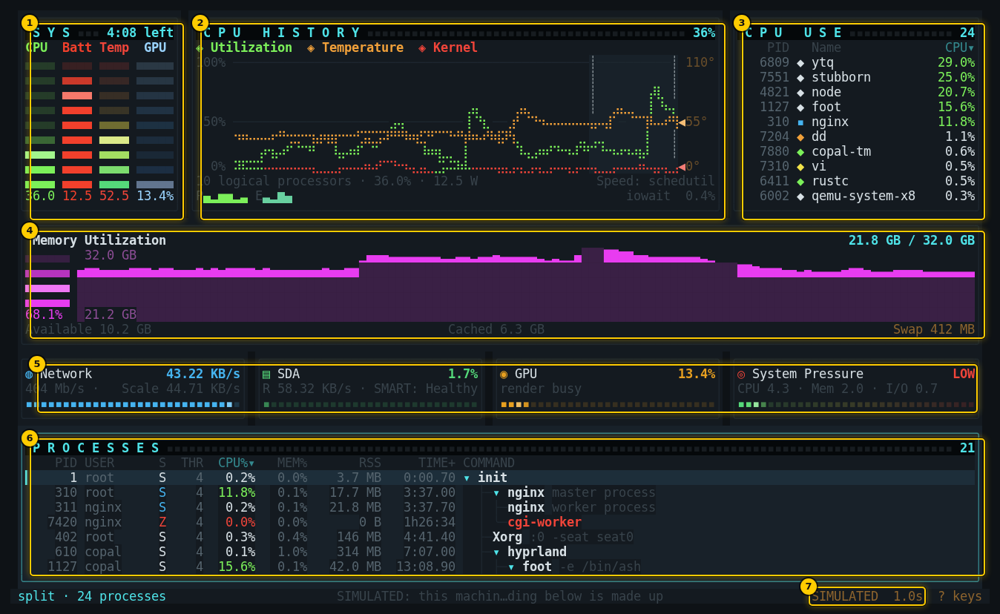

*The default split view, 132×40: the instrument panel above, the process browser below.*

1. **SYS**, the instrument cluster: four ladder meters (CPU, Battery, Temp, GPU by default) and a
   readout cycled with `w` (here the time remaining on battery).
2. **CPU HISTORY**: a braille strip chart with three series and their own axes.
3. **CPU USE**, the Roll: what is using the machine, sorted by CPU.
4. **Memory Utilization**: a ladder and an area chart over the full width.
5. The tile rail: Network, Storage, a configurable slot (GPU here) and System Pressure.
6. **PROCESSES**, the Browser: the nesting process tree, the half a sensor panel does not have.
7. The status bar: `SIMULATED` whenever the readings are not from a real `/proc`, and the tick period.

**Check yourself**
- Which part answers "what is running and what shall I do about it", and which answers "what is using the machine"?
- Where would you look to know whether the readings on screen are real?

## 2. The instrument panel: watch

**Why it exists.** The half-second glance. A sensor dashboard translated into character cells
rather than approximated by them: each part earns its place, and every hex value, glyph and
sampling period is in the design report before it was in code.

**How it fits.** The panel says whether something is wrong; the Browser below it says which
process it is. `F1` shows the panel alone, `F2` the split, `F3` the Browser alone.

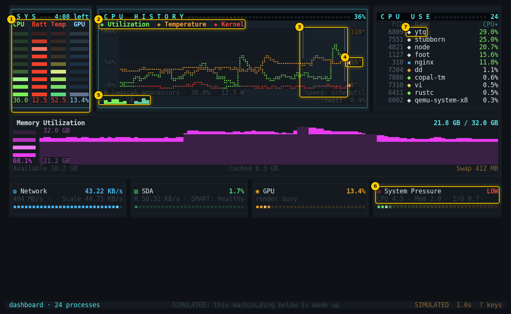

*The dashboard view (`F1`), 132×40.*

1. **Ladder meters whose empty segments are still their own colour.** An unlit CPU segment is
   dark green, not grey, so a gauge at 3 % still reads as *that* gauge and four columns stay four
   objects. The top lit segment blooms; the one segment straddling the value is lit in
   proportion, so the meter moves smoothly instead of stepping.
2. **A legend that is also a control.** `1`, `2`, `3` toggle Utilization, Temperature and Kernel.
3. **The brushed time band**, shared by every history on screen: the same time selection in
   every chart.
4. **Dual axes and carets.** The right axis belongs to Temperature alone and is drawn in its
   colour; a `◀` per series points at its current value.
5. **The per-core strip**, grouped by class (`P▄▂▅▅▂▃ E▃▂▆▄`): a single-threaded build pinning one
   big core while the rest idle is invisible in an average.
6. **A tile whose headline is a word** (`LOW`) when that is the honest answer for a quantity
   nobody can act on.
7. **Mark glyphs in the Roll**: `◆` an ordinary process, `▪` a supervised service, `◈` this
   program; the glyph's colour is the process state.

The rail's slot tile is chosen in configuration (`slot.tile = gpu | swap-rate | load | processes
| throttle`), as are the SYS meters (`sys.meters`) and the readout (`sys.readout`). Every
reading carries its age: a value older than three of its own periods is drawn washed out,
because an instrument that has stopped must not look like one reading zero.

**Check yourself**
- Why is an empty ladder segment tinted rather than grey?
- What does the core-class strip show that the CPU total cannot?

## 3. The process browser: find

**Why it exists.** A sensor panel tells you the machine is busy; it cannot tell you which of forty
renderer processes is the one, or what to do about it. The Browser is a nesting tree because
parentage is what decides how a process is stopped.

**How it fits.** The selection here is what the Inspector, Services and the halt plan act on.

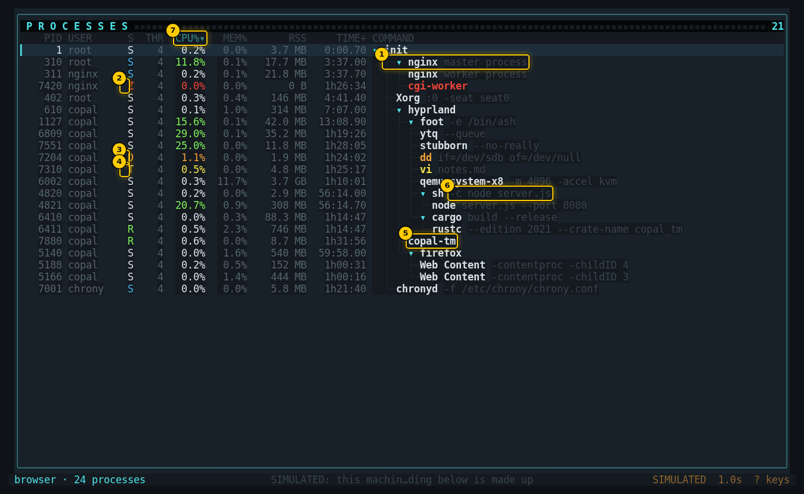

*The Browser (`F3`) in tree mode, sorted by CPU.*

1. **The tree.** Children are indented under their parent with guides; a parent carries `▾`.
2. **A zombie** (`Z`, red): already dead, waiting to be reaped.
3. **Uninterruptible sleep** (`D`, orange): the state in which no signal will be delivered.
4. **Stopped** (`T`, yellow).
5. **This program's own row**, in cyan.
6. **Arguments drawn dim** behind the program name, so a long command line stays scannable.
   (This one is the shell wrapper the halt plan in Part 6 sees through.)
7. **The sort column**, with its direction. `s` cycles the sort, `r` reverses, `t` toggles the tree.

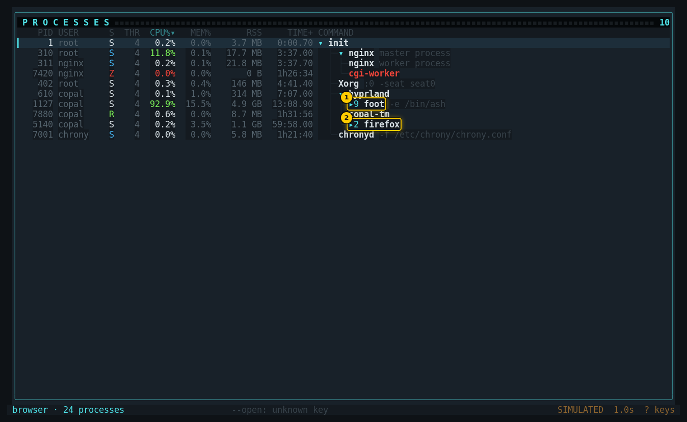

*The same tree with every parent folded (`←` on a row folds it, `→` opens it).*

1. **`▸9 foot`**: a terminal holding nine descendants. Its 92.9 % and 4.9 GB are the *subtree's*
   totals, not its own. The count rides on the disclosure triangle so it can never be mistaken
   for part of the command line.
2. **`▸2 firefox`**: two content processes folded into one readable row. This is why the tree,
   not the flat list, is the default.

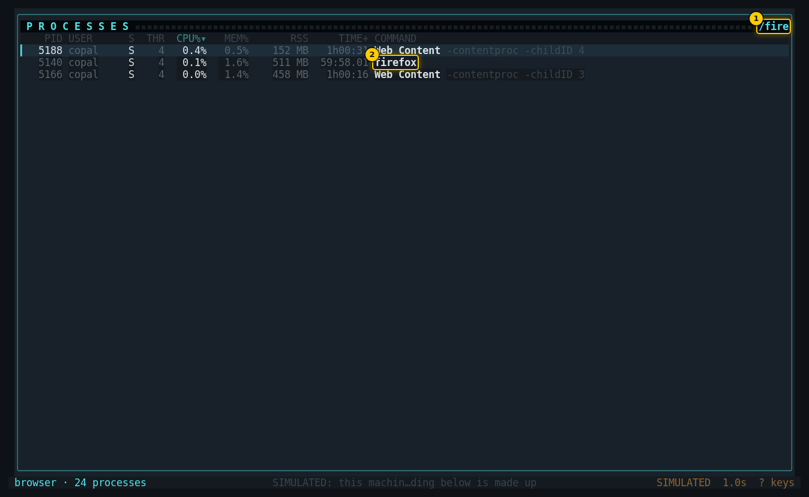

*Live: `/`, then `fire`, then `Enter`.*

1. The filter, shown in the title strip in place of the count. It is a case-insensitive match on
   the name, the command line and the user, or an exact pid.
2. The matches, `firefox` and its two content processes, as a flat list in the current sort order.

`Space` marks a process, and the title strip counts the marks (`21 · 2 marked`). `K` shows the kernel threads, hidden by default.

**Check yourself**
- A collapsed parent shows 92.9 % CPU. Is that process itself busy?
- Which three states colour a row, and what does each mean for a signal?

## 4. The Inspector: everything about one process

**Why it exists.** Everything about one process, including the things that decide whether it can
be stopped. Its sections are named as NeXTSTEP's Inspector named them; Network is added because
"what is this process doing on the network" is asked constantly and `/proc` will answer it.

**How it fits.** It is opened on the selection with `Enter` or `i`, and the expensive reads
(command line, cgroup, the fd directory, the socket join) happen only then, on selection, never on
the tick.

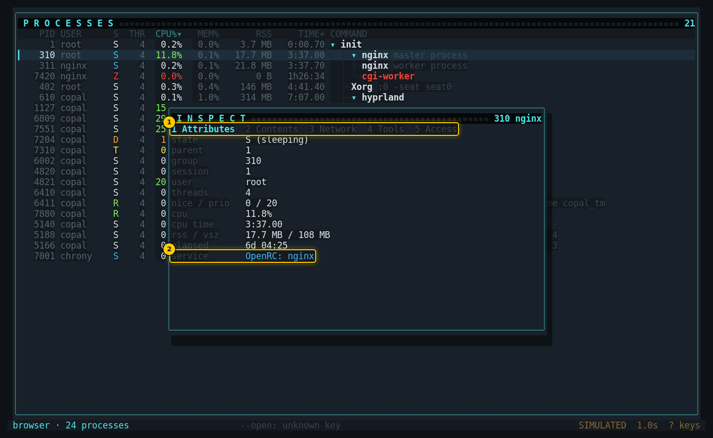

*The Inspector on `nginx`, section 1, Attributes.*

1. The five sections: Attributes, Contents, Network, Tools, Access.
2. **The service line**: this process is an OpenRC service, which changes how it should be
   stopped (Part 6).

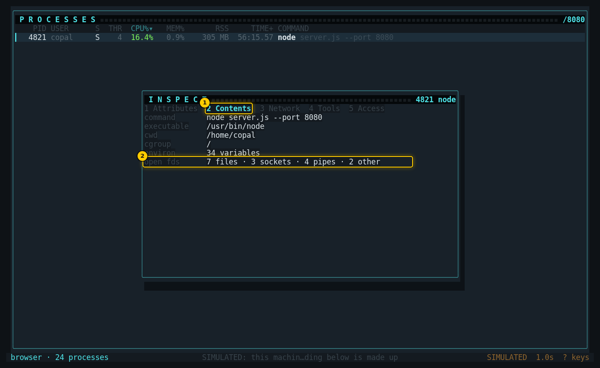

*Live: `/8080`, `Enter`, `Enter`, `2`: the Inspector on the `node` server, section 2, Contents.*

1. The full command line, the executable, the working directory, the cgroup and the environment's size.
2. Open file descriptors counted by class: files, sockets, pipes, other.

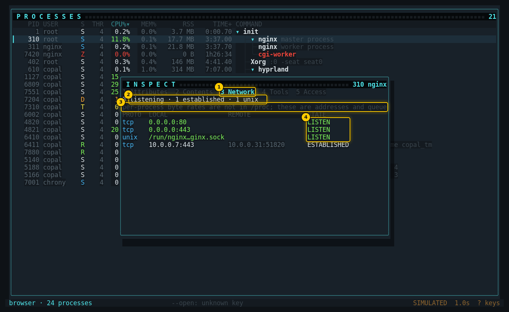

*The Inspector on `nginx`, section 3, Network.*

1. **Network.** Linux keeps no per-process network table. It keeps two halves of one, joined by an
   inode: `/proc/[pid]/fd/*` reads back as `socket:[12345]`, and `/proc/net/{tcp,tcp6,udp,udp6,unix}`
   carry the same inode in a column. Match them and a file descriptor becomes an address.
2. The summary: listening, established, Unix.
3. **The caveat, stated once:** per-process byte *rates* are not in `/proc` (they need taskstats,
   netlink or eBPF, none of which is a file read). Guessing would be worse than the gap.
4. `LISTEN` rows first, in green: "what is holding port 8080" is one keystroke, not another
   program to install on the node.

Section 4, Tools, is the halt plan (Part 6). Section 5, Access, holds the signal table: the
`SigIgn`, `SigCgt` and `SigBlk` masks from `/proc/[pid]/status`, decoded into `trapped`,
`ignored`, `blocked` and `default`. It is rendered and tested
(`the_inspectors_access_section_decodes_the_signal_masks`), but there is no picture of it here:
in 0.1.3 the Inspector takes the keys `1` to `4` only, so section 5 cannot be reached from the
keyboard, although the keys page says `1-5`. The same dispositions are on the Services menu,
next.

**Check yourself**
- Which two files does the Network section join, and on what?
- Why are the command line and the sockets read on selection and not every tick?

## 5. Services: the trap visible before it is hit

**Why it exists.** Every Linux process publishes three hexadecimal words in `/proc/[pid]/status`:
the signals it ignores, the ones it has installed a handler for, and the ones it has blocked. No
common task manager shows them. They are the difference between *"terminate did not work"* and
*"terminate was never going to work"*.

**How it fits.** `k` on the selection opens Services (NeXTSTEP's word): one signal, sent on
purpose, with its disposition beside it. It is the direct tool; the halt plan is the considered one.

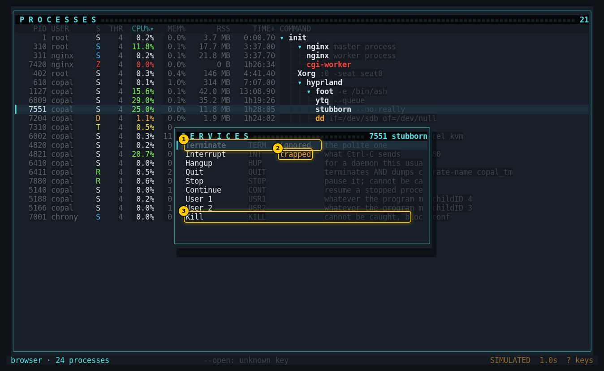

*`k` on `stubborn` (pid 7551).*

1. **Terminate is ignored**, so it is greyed with the reason rather than quietly doing nothing.
2. **Interrupt is trapped**: a handler is installed, so a polite stop may be a clean shutdown, or
   it may be swallowed.
3. **Kill** cannot be caught, blocked or ignored. Each item also says what the signal is for:
   Quit "terminates AND dumps core", Hangup is usually a reload for a daemon.

**Check yourself**
- What do `trapped` and `ignored` each predict about sending `TERM`?

## 6. The halt plan: the right addressee, then the ladder

**Why it exists.** Ending a process is the one irreversible thing this program does, and the
process under the cursor is often the wrong one to signal. The plan diagnoses the target first,
finds the right addressee, shows the exact equivalent command line, and sends nothing until you
confirm. A task manager that hides what it is about to do is asking to be trusted; one that
prints it is asking to be checked.

**How it fits.** `x` on the selection; the same plan is the Inspector's Tools section. It reads
the state from the Browser, the masks from Services and the service map from the Inspector.

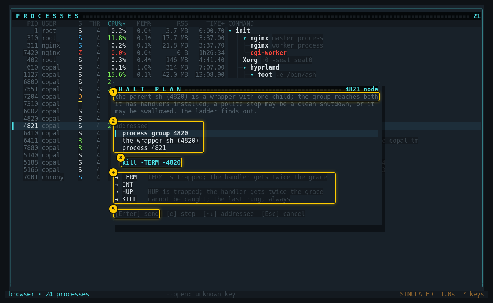

*`x` on `node` (4821), the child of `sh -c node server.js` (4820).*

1. **The diagnosis**: the parent `sh` is a wrapper with one child, so signalling the child would
   leave the wrapper.
2. **The addressees, in the order that works most often**: the process group (what `Ctrl-C`
   sends; it reaches every member, so one member's trap cannot hold the others), the wrapper,
   the process itself. `↑↓` chooses.
3. **The exact command line**, `kill -TERM -4820`, before anything is sent.
4. **The ladder**: TERM → INT → HUP → KILL. A trapped signal's grace is doubled; KILL is always last.
5. `[Enter] send  [e] step  [Esc] cancel`: confirmation is a different key from the one that
   opened the plan. (This guide never presses it.)

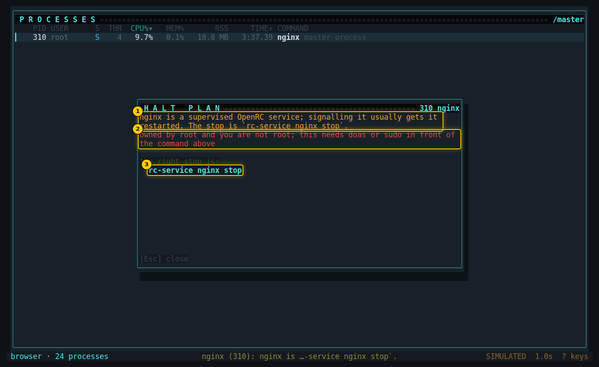

*Live: `/master`, `Enter`, `x`: the plan for `nginx`.*

1. **A supervised OpenRC service**: a signal is the wrong instrument however well aimed, and
   killing it just gets it restarted. *This is the most common way a kill "does not work", and it
   is not a trap at all.*
2. **A refusal, with the privilege it needs**: nginx is root's, and the plan says `doas` or
   `sudo` would be needed rather than failing at the syscall.
3. **The right stop**: `rc-service nginx stop`.

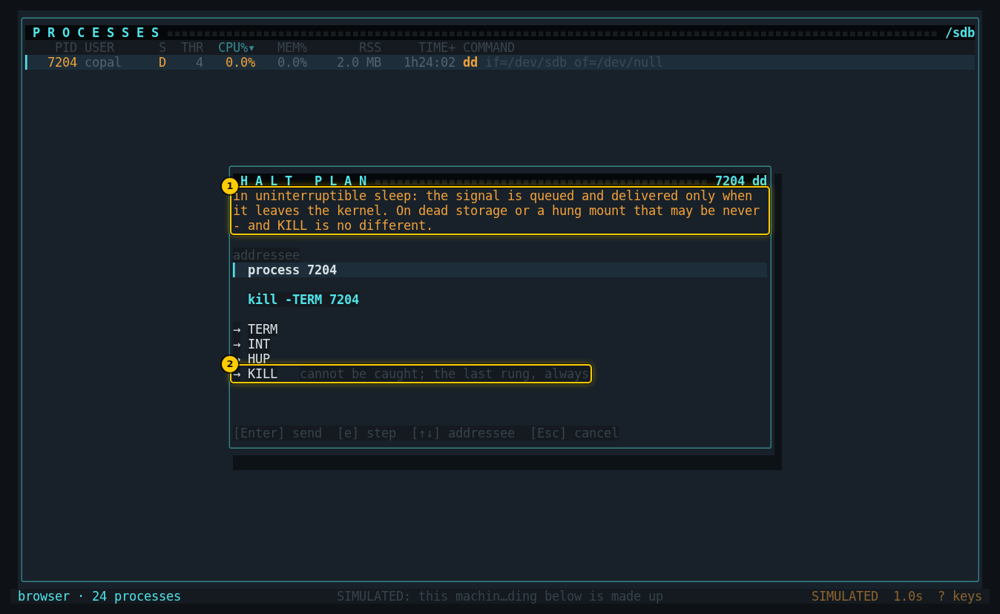

*Live: `/sdb`, `Enter`, `x`: the plan for `dd` reading a disk, in uninterruptible sleep.*

1. The signal is delivered only when it leaves the kernel, which on dead storage may be never,
   **and KILL is no different**. The plan says so rather than promising otherwise.
2. KILL is still the last rung, always.

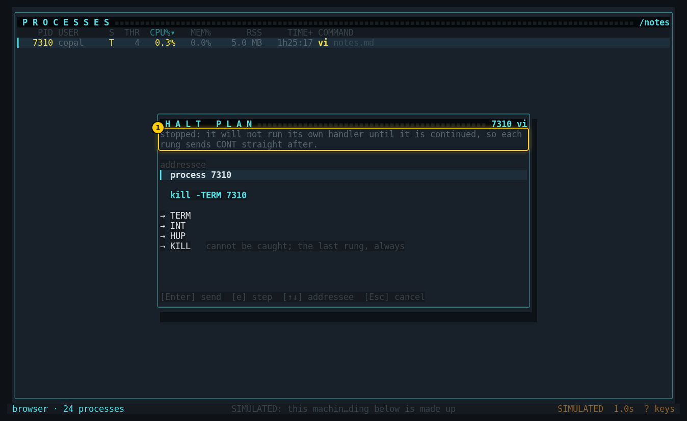

*Live: `/notes`, `Enter`, `x`: the plan for a stopped `vi`.*

1. A stopped process will not run its own handler until it is continued, so every rung sends
   `CONT` straight after.

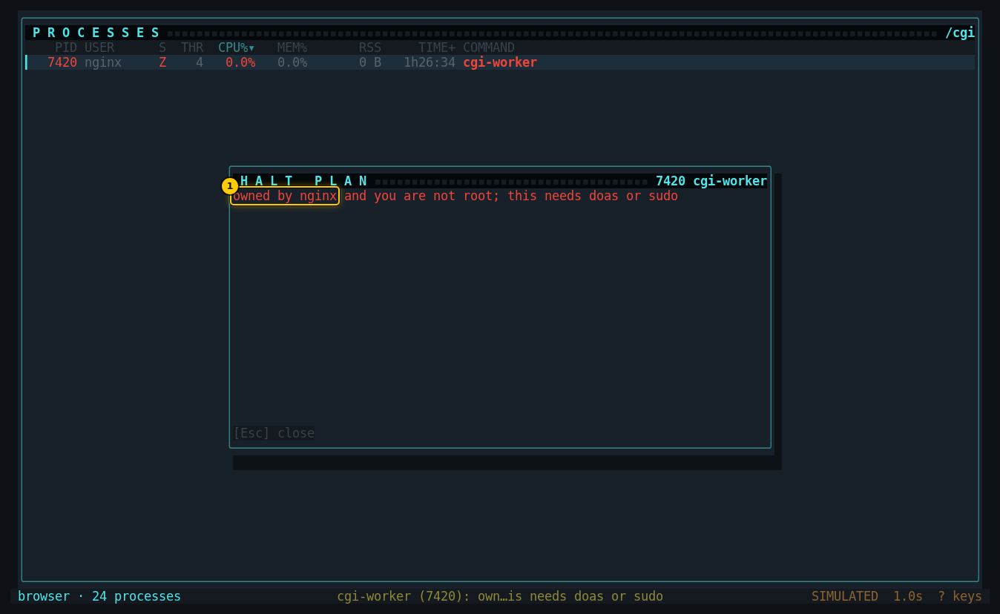

*Live: `/cgi`, `Enter`, `x`: the zombie `cgi-worker`.*

1. **Refused**: pid 1, kernel threads and another user's process are refused, with what privilege
   would be needed. The simulated zombie belongs to `nginx`, so the refusal comes first. For a
   zombie of your own, the plan says no signal can affect it (it is already dead and waiting to be
   reaped) and offers the **parent** instead; that case is covered by the test
   `a_zombie_offers_its_parent_and_says_why`.

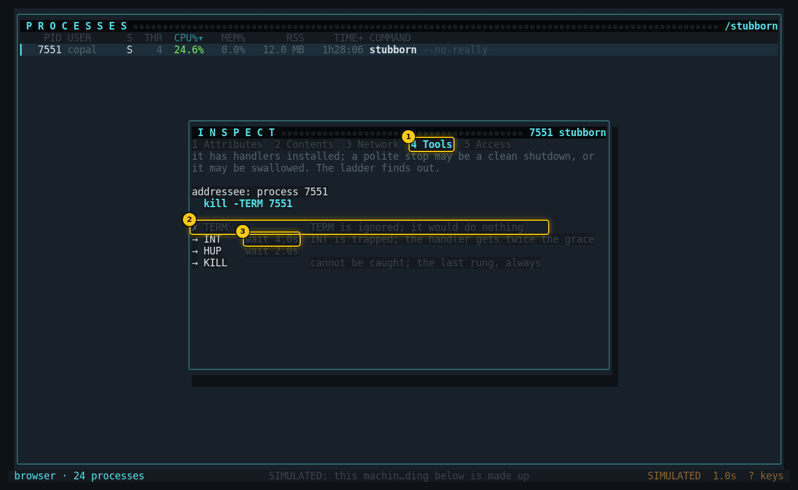

*Live: `/stubborn`, `Enter`, `Enter`, `4`: the same plan inside the Inspector.*

1. Tools: the halt plan, computed and shown before anything is sent.
2. **TERM is struck out** (`✗`): the mask says it is ignored, so it would do nothing.
3. **INT is trapped**, so its wait is doubled to 4.0 s from the default `halt.grace` of 2.0 s.

When a ladder runs, it re-reads the target between rungs, and the Transcript records **which rung
actually worked**: the piece of knowledge the whole feature exists to produce. `Esc` stops it
where it is.

**Check yourself**
- Why is the process group offered before the process itself?
- What does the plan offer for a supervised daemon, and why not a signal?
- Which state makes even KILL wait?

## 7. The Transcript and the keys

**Why it exists.** A program whose job is to end other programs must keep a record of what it
ended. The Transcript (Smalltalk's word for the system's running log) records every signal sent
with its exact command line, every refusal and why, every escalation, and every start-up fallback.

**How it fits.** Its last line is always in the status bar; `T` opens the whole log.

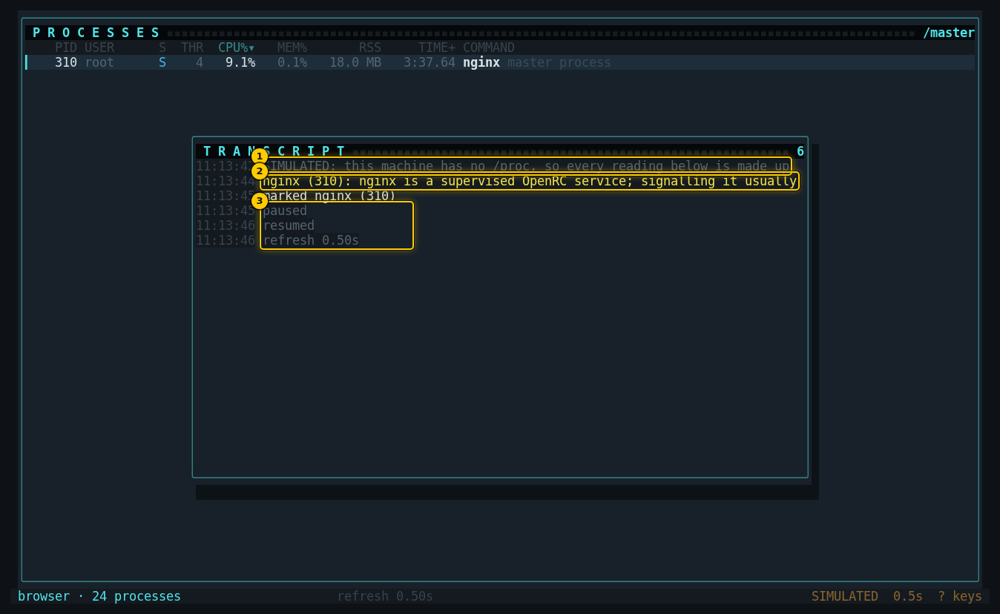

*Live: a halt plan opened on nginx and closed, a mark, a pause and resume, a faster tick, then `T`.*

1. **The first line says the readings are simulated** (this line reads "this machine has no
   /proc" even when `--simulate` was asked for on a machine that has one).
2. **A refusal, in yellow**, with the reason.
3. Actions and configuration changes, stamped `HH:MM:SS`: marked, paused, resumed, `refresh 0.50s`.

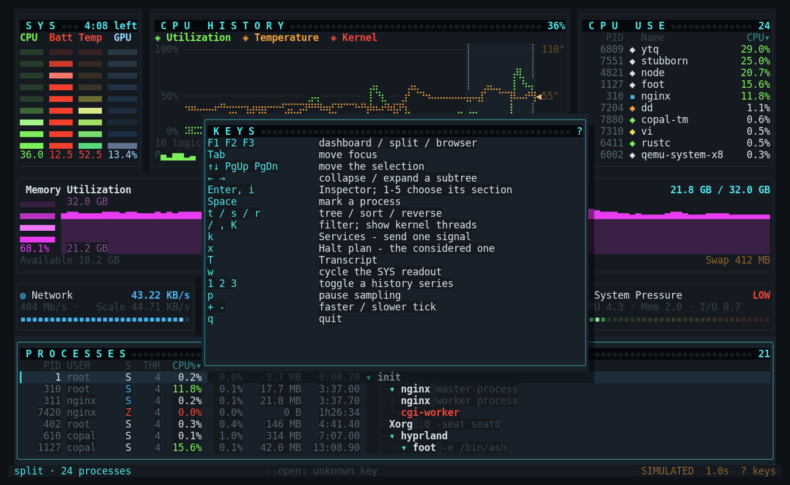

*`?`: every key on one panel, over the split view.*

The keys, in short: `F1 F2 F3` views; `↑↓ PgUp PgDn` move; `← →` fold; `Enter`/`i` Inspector;
`Space` mark; `t s r` tree, sort, reverse; `/` filter, `K` kernel threads; **`k` Services**;
**`x` halt plan**; `T` Transcript; `w` cycle the SYS readout; `1 2 3` history series; `p` pause,
`+`/`-` tick; `?` keys; `q` quit.

**Check yourself**
- After a halt ladder has run, where do you find out which signal ended the process?

## 8. Honest about what it costs, and legible everywhere

**Why it exists.** *A task manager that appears in the top five of its own table has failed at its
job*, and a fleet node may be a narrow console with no braille font, no colour, and no internet.

**How it fits.** These are rules every other part obeys, not features you switch on.

| Rule | What it means |
|---|---|
| Nothing forks on the tick | Every reading is a file read. The one fork (`smartctl`) runs on its own thread at 1/300 the rate. |
| Cost scales with what is shown | `/proc/[pid]/status` is read for the rows on screen only: on a 400-process machine, 1,600 lines a second instead of 22,000. |
| It throttles itself | On battery below 15 %, or if its own CPU share passes 2 % for ten ticks, the period doubles and the Transcript says why. |
| Every reading carries its age | A value older than three of its periods is drawn washed out. |
| Zero dependencies | One crate, nothing but `std`. A Copal fleet node never reaches the internet, so a dependency is a crate fetch that fails on the one machine this is meant to run on. Raw mode is two `stty` flags. |

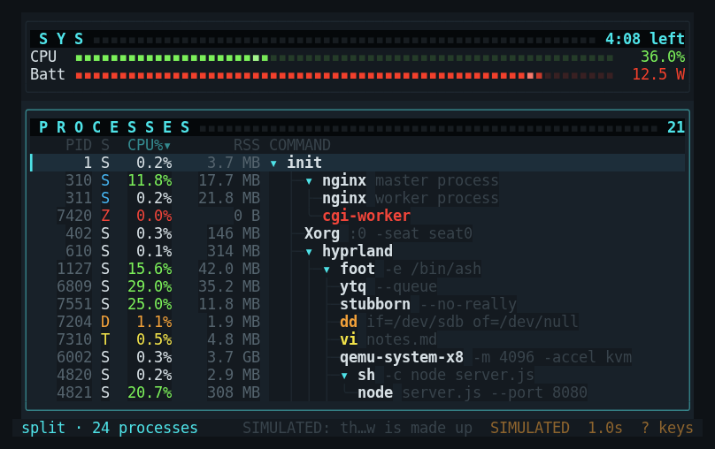

*78×24. Under 80 columns the dashboard becomes a gauge rail and the Browser takes the room.*

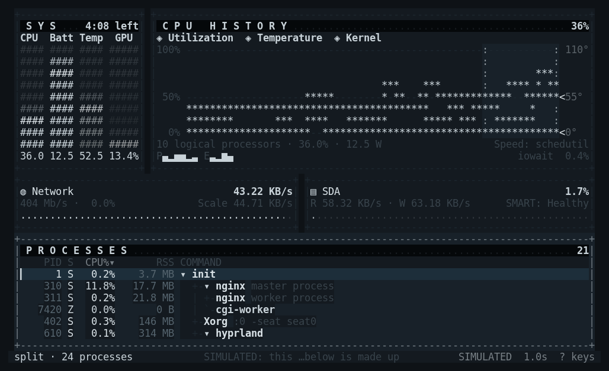

*100×30 with `--charset ascii --theme mono`: the ladders become `####`, the plot `*`, and colour
carries nothing; shape carries everything.*

The degradation, from the README: **width** 132+ full, 100–131 a narrower Roll, 80–99 no Roll,
under 80 the gauge rail; **colour** true colour, or the nearest of sixteen ANSI colours computed
per cell; **glyphs** braille → half blocks → `*` and `+ - |`. In 0.1.3 the `ascii` set is not yet
pure ASCII: the legend's `◈`, the tree's `▾`, the tile icons, the core strip and the `·`
separators still come through, as the picture shows.

**Check yourself**
- Which reads happen on every tick, and which only on selection?
- What would `charset = blocks` be for?

## 9. How it fits together

**Why it exists.** The program is one loop: read `/proc` cheaply, show the machine, find the
process, learn what stopping it will actually do, do it in the open, and write it down.

**How it fits.** Each part exists because the part before it is not enough on its own.

| Stage | Feature | Why it is not enough alone |
|---|---|---|
| Read | The sampling schedule; `--simulate` where there is no `/proc` | Numbers without a picture are just numbers; and every one has an age. |
| Watch | SYS, CPU History, the Roll, Memory, the tile rail | Says the machine is busy, not which process or what to do about it. |
| Find | The Browser: tree, roll-up, filter, marks | Finds the process; says nothing about whether it can be stopped. |
| Inspect | The Inspector: Attributes, Contents, Network | Says what the process is and holds; not what a signal will do to it. |
| Predict | Services and the signal dispositions | Shows the trap; does not pick the right target or route around it. |
| Act | The halt plan: addressee, command line, ladder, confirmation | Acts, but its result has to be remembered to be learned from. |
| Record | The Transcript | Closes the loop: what was sent, what was refused, and which rung worked. |

Built with `make` (the Makefile is the front door; cargo is what it calls), checked with
`make check` (fmt, clippy `-D warnings`, 98 tests), and looked at without a terminal with
`make shot`. MIT licensed.
